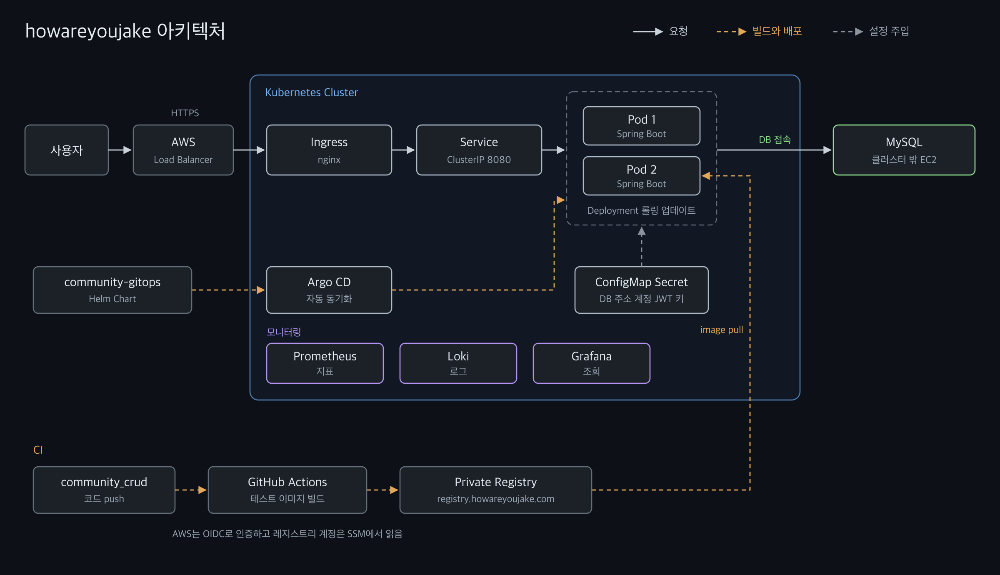

# howareyoujake

스포츠를 주제로 게시글, 댓글, 좋아요, 검색을 제공하는 커뮤니티 서비스의 백엔드입니다. 개발부터 Kubernetes 배포까지 혼자 진행했습니다.


- 기간: 2026.05 ~ 2026.08 (개인 프로젝트)
- 배포 설정: [community-gitops](https://github.com/dddf-1/community-gitops)

## 주요 개선

| 문제 | 조치 | 결과 |
| --- | --- | --- |
| 조회수 Lost Update | 조회 후 Java에서 +1 하고 저장하던 흐름을 DB 원자적 UPDATE(`view_count = view_count + 1`)로 변경 | 동시 요청 100건 중 28건 반영 → 100건 반영 |
| 게시글 목록 N+1 | 작성자, 댓글 수, 좋아요 수를 JPQL DTO Projection 한 번으로 조회 | 쿼리 11회 → 1회 |
| 깊은 페이지 조회 | `(created_at, post_id)` 복합 인덱스와 커서 페이지네이션 추가 | 1만 건 기준 42.3ms → 17.0ms (로컬 3회 평균) |

- 조회수 UPDATE 후 영속성 컨텍스트를 비워 최신 값을 반환하고, 게시글 수정 충돌은 JPA `@Version`으로 감지합니다.
- 인덱스 스크립트: [`docs/sql/post-list-index.sql`](docs/sql/post-list-index.sql)

## 기능

| 영역 | 내용 |
| --- | --- |
| 인증 | 회원가입, 로그인, 로그아웃, 인증 확인. JWT를 `Authorization` 헤더와 `HttpOnly` 쿠키 모두로 받음 |
| 회원 | 이메일/닉네임 중복 확인, 내 정보 조회와 수정, 비밀번호 변경, 탈퇴 |
| 게시글 | 작성, 조회, 수정, 삭제, 이미지 첨부, 조회수, 페이지 기반과 커서 기반 목록, 제목/본문 검색(최신순, 관련도순) |
| 댓글 | 조회, 작성, 수정, 삭제(작성자만) |
| 좋아요 | 좋아요와 취소, 중복 방지 |
| 파일 | 5MB 이하 JPG, PNG, GIF, WebP만 허용, UUID 파일명으로 저장 |

- 비밀번호는 BCrypt로 저장하고 서버 세션은 쓰지 않습니다.
- 게시글과 회원은 `deleted_at`으로 Soft Delete 합니다. 탈퇴하면 작성 게시글은 삭제 처리, 댓글과 좋아요는 지우고, 이메일과 닉네임을 대체 값으로 바꿔 같은 정보로 다시 가입할 수 있게 했습니다.
- 탈퇴한 회원은 만료 전 JWT를 보내도 인증되지 않습니다.

## 아키텍처



- AWS Load Balancer → Ingress → Service → Pod 2개, DB는 클러스터 밖 MySQL
- 지표는 Prometheus, 로그는 Loki로 모으고 Grafana에서 확인
- GitHub Actions에서 테스트 후 이미지를 빌드해 사설 레지스트리에 push. AWS는 OIDC로 인증하고 레지스트리 계정은 SSM Parameter Store에서 읽음
- 배포는 [community-gitops](https://github.com/dddf-1/community-gitops)의 Helm Chart를 ArgoCD가 동기화

## 로컬 실행

JDK 17과 MySQL이 필요합니다.

```bash
export JWT_SECRET="32바이트-이상의-임의-문자열"
export DB_URL="jdbc:mysql://localhost:3306/community?serverTimezone=Asia/Seoul&characterEncoding=UTF-8"
export DB_USERNAME="root"
export DB_PASSWORD="비밀번호"
./gradlew bootRun
```

`GET http://localhost:8080/health`가 `OK`를 반환하면 정상입니다. 그 밖의 설정(`CORS_ALLOWED_ORIGINS`, `COOKIE_SECURE`, `UPLOAD_DIR` 등)은 [`application.properties`](src/main/resources/application.properties)에서 기본값을 확인할 수 있습니다.

## 테스트

```bash
SPRING_PROFILES_ACTIVE=test ./gradlew test
```

H2와 MockMvc로 회원가입부터 로그인, 게시글, 댓글, 좋아요, 검색, 삭제까지 이어지는 흐름과 인증 없는 요청의 401 응답을 검증합니다.
